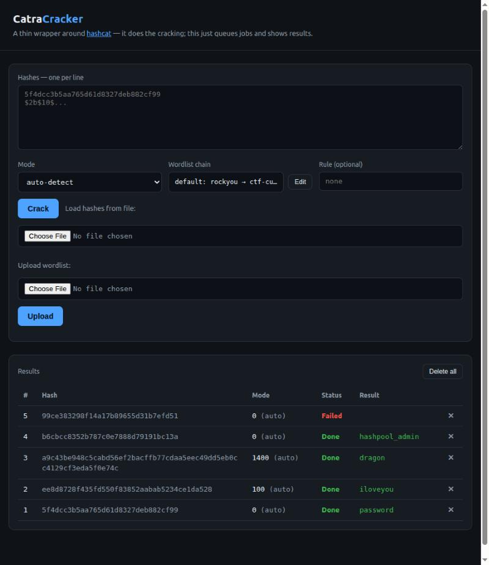

# CatraCracker

**A small, self-hostable web + CLI front end for [hashcat](https://hashcat.net/hashcat/).**
Paste hashes, let it auto-detect the type, and watch them crack in the background on your GPU box.

> It's a thin wrapper — hashcat does the actual cracking. CatraCracker is the job queue, the auto-detection, and the UI around it.
>
> **Built with AI:** designed and written collaboratively with [Claude](https://www.anthropic.com/claude) (Anthropic) — "vibecoded" end to end, and presented as such. See [How this was built](#how-this-was-built).



---

## What it's for

During a CTF you collect hashes faster than you can crack them, and you want cracking to run **in the background** on a dedicated GPU machine while you keep enumerating from your laptop. CatraCracker is that: a long-running service you submit hashes to over HTTP, from a browser, a CLI, or plain `curl`.

It is deliberately **single-user and CLI/HTTP-first** — no accounts, no multi-tenant access groups, no ceremony. Just a queue and a cracker.

## Features

- **Submit with just a hash.** The hashcat `-m` mode is auto-detected from the hash's shape; override it when you need to.
- **Wordlist pivot chains.** A job tries an ordered list of wordlists, stopping at the first crack. Build the chain in the UI (add / remove / reorder) or send it over the API.
- **Rules.** Apply a hashcat `.rule` file (e.g. `best64`) on top of a wordlist.
- **Three interfaces, one API.** A web UI, a small CLI, and a plain HTTP API that `curl` can drive completely.
- **Durable queue.** Jobs live in SQLite and survive restarts, so it runs happily as a systemd service.
- **Upload wordlists at runtime** from the browser or `curl` — no redeploy.
- **Live results** — the UI polls and updates as jobs resolve; export recovered creds as `hash:password`.

## How it works

```
 client (browser / CLI / curl, anywhere)
             │  HTTP
             ▼
        server.js ──────────────┐   Express API + static web UI
             │                  │
             ▼                  │
        SQLite (jobs.js) ◄──────┘   durable job queue + history
             ▲
             │  claim / record
        worker.js                   long-running poller
             │
             ▼
        driver.js ──► hashcat        the only process boundary
```

Each file owns exactly one concern:

| File | Responsibility |
|---|---|
| `src/config.js` | All env-driven settings (nothing else reads `process.env`) |
| `src/db.js` | Opens SQLite, creates the schema, enables WAL |
| `src/jobs.js` | **The only** module that touches the database |
| `src/hashid.js` | Guesses the hashcat mode from a hash's shape |
| `src/wordlists.js` / `src/rules.js` | Name → file-path registries |
| `src/driver.js` | **The only** module that spawns hashcat |
| `src/server.js` | Express API + serves the web UI |
| `src/worker.js` | Claims jobs and runs them through the driver |
| `src/app.js` | Combined entrypoint (API + worker in one process) |
| `src/cli.js` | Thin HTTP client |
| `public/index.html` | The web UI (dependency-free vanilla JS) |

### A few design decisions worth calling out

- **A job is a *sequence of steps*, not one hashcat run.** Each step is a `{ wordlist, rule }` pair, tried in order. The worker advances through the queue, appending every attempt to a history, and only finalizes the job (`done` / `failed`) once something cracks or the chain is exhausted. Wordlist pivoting and rules fall naturally out of this one model.
- **SQLite over a JSON file or a bigger database.** The API (enqueueing) and the worker (claiming) are separate concerns touching the same data, and claiming must be atomic so a job is never run twice. A plain JSON file would mean hand-rolling locking; a server database would mean a daemon to run. SQLite via `better-sqlite3` is the middle ground: one file, no daemon, real transactions. Claiming is a single transaction; WAL keeps reads fast during writes.
- **hashcat runs in a child process, so one process is enough.** Because the heavy work is a spawned `hashcat` process (not work on Node's event loop), the HTTP server stays responsive even when the worker runs *in the same process*. That's why combined "web mode" is safe — and why the split mode is a choice (crash isolation on a big multi-GPU box), not a requirement.
- **Auto-detection is a single best guess.** `hashid.js` is a small ordered table — distinctive prefixes first (`$2b$`, `$6$`, …), then bare-hex length. If it guesses wrong, you resubmit with an explicit mode. (A bare 32-hex hash is ambiguous between MD5 and NTLM; it defaults to MD5 — pass `mode: 1000` for NTLM.)

### Job schema

```sql
CREATE TABLE jobs (
  id INTEGER PRIMARY KEY AUTOINCREMENT,
  hash TEXT NOT NULL,
  mode INTEGER NOT NULL,
  mode_source TEXT NOT NULL,             -- 'auto' | 'manual'
  step_queue TEXT NOT NULL,              -- JSON [{ wordlist, rule }, ...], in try-order
  current_step_index INTEGER NOT NULL DEFAULT 0,
  status TEXT NOT NULL DEFAULT 'queued', -- 'queued' | 'running' | 'done' | 'failed'
  result TEXT,                           -- cracked plaintext
  attempts TEXT NOT NULL DEFAULT '[]',   -- JSON history of every step tried
  created_at TEXT NOT NULL,
  updated_at TEXT NOT NULL
);
```

## Tech stack

Node.js · Express · better-sqlite3 · commander (CLI) · hashcat · a single dependency-free HTML/JS page for the UI.

## Getting started

### Prerequisites

- **Node.js 18+** (uses the built-in `fetch`).
- **hashcat** installed and on `PATH` (`hashcat -I` should list your GPU).
- A GPU is strongly recommended; CPU works for testing but is slow.

### Install

```bash
git clone <your-fork-url> catracracker
cd catracracker
npm install
```

### Wordlists & rules

These are **not** bundled (they're large and/or come from hashcat). Put them in place:

```bash
# wordlists/<name>.txt  — the name is the filename without .txt
cp /usr/share/wordlists/rockyou.txt wordlists/rockyou.txt

# rules/<name>.rule
cp /usr/share/hashcat/rules/best64.rule rules/best64.rule
```

`wordlists/ctf-custom.txt` ships with the repo as a small, editable example list. The default pivot chain is `rockyou → ctf-custom`.

### Run

**Combined web mode** (simplest — one process serves the UI + API and runs the worker):

```bash
npm run web      # then open http://localhost:3000
```

**Split mode** (API and worker as separate processes — crash isolation on a big box):

```bash
npm start        # API + web UI
npm run worker   # the cracking worker (in another terminal)
```

## Usage

### Web UI

Open `http://localhost:3000`, paste hashes (one per line), optionally pick a mode / build a wordlist chain / set a rule, and hit **Crack**. The results table updates live; delete individual rows or clear all.

### CLI

```bash
node src/cli.js submit --hash 5f4dcc3b5aa765d61d8327deb882cf99
node src/cli.js submit --hash <hash> --mode 1000 --wordlists rockyou,ctf-custom --rule best64
node src/cli.js status <jobId>
node src/cli.js status all --simple   # hash:password lines for cracked jobs
node src/cli.js list
node src/cli.js wordlists
```

Point it at a remote server with `CATRACRACKER_API_URL`.

### HTTP API (curl is a first-class client)

| Action | curl |
|---|---|
| Submit (hash only) | `curl -X POST host/jobs -H 'Content-Type: application/json' -d '{"hash":"5f4d..."}'` |
| Submit with options | `... -d '{"hash":"...","mode":1000,"wordlists":["rockyou","ctf-custom"],"rule":"best64"}'` |
| One job | `curl host/jobs/1` |
| All jobs | `curl host/jobs` |
| Recovered creds | `curl host/jobs?simple` |
| Delete one / all | `curl -X DELETE host/jobs/1` · `curl -X DELETE host/jobs` |
| Known modes | `curl host/modes` |
| List wordlists | `curl host/wordlists` |
| Upload a wordlist | `curl -X POST "host/wordlists?name=mylist" -H 'Content-Type: text/plain' --data-binary @mylist.txt` |

Every field but `hash` is optional. `?simple` prints `hash:password` lines, so `curl host/jobs?simple > creds.txt` is the whole creds export.

## Configuration

All settings come from the environment (see `src/config.js`):

| Variable | Default | Purpose |
|---|---|---|
| `CATRACRACKER_PORT` | `3000` | HTTP port |
| `CATRACRACKER_DB_PATH` | `./catracracker.db` | SQLite file |
| `CATRACRACKER_HASHCAT_BIN` | `hashcat` | hashcat binary / path |
| `CATRACRACKER_WORDLISTS_DIR` | `./wordlists` | wordlist files |
| `CATRACRACKER_RULES_DIR` | `./rules` | rule files |
| `CATRACRACKER_API_URL` | `http://localhost:3000` | CLI target (client-side) |

## Running as a service (systemd)

Because it's one env-configured long-running process, it drops straight into a unit:

```ini
# /etc/systemd/system/catracracker.service
[Unit]
Description=CatraCracker
After=network.target

[Service]
WorkingDirectory=/opt/catracracker
ExecStart=/usr/bin/node src/app.js
Environment=CATRACRACKER_PORT=3000
Restart=on-failure
User=catracracker

[Install]
WantedBy=multi-user.target
```

```bash
systemctl enable --now catracracker
```

The SQLite queue persists across restarts, so in-flight jobs resume.

## Testing

`test/harness.js` is an integration suite: it generates hashes with known plaintexts across the full matrix (every format, mode detection, wordlist pivot, rules, failed/error paths, the NTLM/MD5 gap) and the API surface, submits them to a **running** server, and verifies each result.

```bash
npm run web   # in one terminal
npm test      # in another (needs rockyou.txt, ctf-custom.txt, best64.rule in place)
```

## Limitations & roadmap

- **MD5 vs NTLM** — a bare 32-hex hash defaults to MD5; pass mode `1000` for NTLM.
- **One job at a time** — the worker runs a single job sequentially. Fine for one GPU (a single hashcat run already uses all of a machine's GPUs); running *multiple* jobs in parallel across cards on a multi-GPU box is future work.
- **No auth** — intended for a trusted single-user network. Bind to localhost / SSH-tunnel, or keep it behind a firewall.

## Security note

This is a tool for **authorized** password cracking — your own CTF challenges, systems you're permitted to test, and security research. Use it accordingly.

## How this was built

CatraCracker was built end to end in a conversation with [Claude](https://www.anthropic.com/claude)
(Anthropic) — the architecture, all of the code, the web UI, the test harness,
and this README. In other words, it's **"vibecoded"**: the direction, the design
decisions, and the review were human; the implementation was AI-generated. It's
published that way on purpose — no pretense that it was hand-written line by line.

## License

Released under the **MIT License** — see [`LICENSE`](LICENSE). hashcat is a
separate project with its own license.
